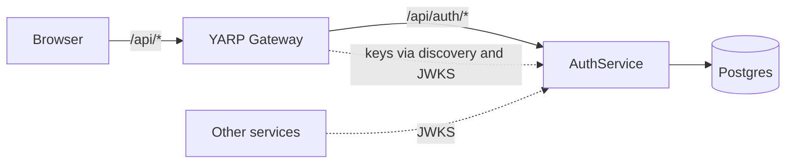

# AuthService

Authentication service built with ASP.NET Core (.NET 10), EF Core and PostgreSQL. It registers and authenticates users, issues JWTs (RS256) and manages rotating refresh tokens. Other services never issue tokens: they only verify signatures using the public key (JWKS).

Part of the FitControl learning system. The repository is a monorepo: this service lives in `services/auth`, and a YARP gateway (`gateway/Gateway`) sits in front of it.

## Architecture



- The gateway lets `/api/auth/*` through without a token and requires a valid JWT on every other route. Services behind the gateway must still validate the token themselves.
- The browser sees a single origin (the gateway), so CORS is not needed and cookies work as expected.

## Endpoints

| Method | Path | Description |
|---|---|---|
| POST | `/api/auth/register` | Registers a user and issues tokens |
| POST | `/api/auth/login` | Logs in and issues tokens |
| POST | `/api/auth/refresh` | Issues a new access token and rotates the refresh token (read from the cookie) |
| POST | `/api/auth/logout` | Revokes the refresh token and deletes the cookie |
| GET | `/api/auth/me` | Returns data from the token, requires `Authorization: Bearer ...` |
| GET | `/.well-known/openid-configuration` | Discovery document: `issuer` and `jwks_uri` |
| GET | `/.well-known/jwks.json` | Public key (`kid`, `n`, `e`) |
| GET | `/health` | Liveness check (includes a database check) |

Passwords are sent only in the request body of `register` and `login` (over TLS in a real deployment) and are stored only as hashes.

## How tokens work

**Access token.** A JWT signed with RS256 and carrying the claims `sub`, `email`, `role` and `jti`. It lives for `Jwt:AccessTokenExpirationMinutes` minutes. The client keeps it in memory (not in localStorage) and sends it in the `Authorization: Bearer` header.

**Refresh token.** 64 random bytes (base64). Only its SHA-256 hash is stored in the database. The client receives it in the HttpOnly cookie `refresh_token` (`Secure`, `SameSite=Strict`, `Path=/api/auth`); it is not in the response body, and JavaScript cannot read it.

**Rotation.** Every `/refresh` call revokes the old token (recording `ReplacedByTokenHash`) and issues a new one.

**Reuse detection.** If an already rotated token is presented more than 10 seconds after rotation, it is treated as theft and all of the user's active tokens are revoked.

**Grace period (10 seconds).** A repeat within this window is treated as a race (multiple tabs, a retry after a network failure) rather than theft, and a new token pair is issued.

**Cleanup.** A background service runs once a day and deletes tokens that expired or were revoked more than 7 days ago. The retention window is needed so that reuse detection keeps working.

**Passwords.** ASP.NET Identity's `PasswordHasher` (PBKDF2 with a random per-password salt). When the hashing parameters become outdated, the hash is upgraded automatically on login.

**Rate limiting.** Policy `auth`: 10 requests per minute per IP, applied to the whole controller except `/me`.

## Signing keys

`RsaKeyManager` (singleton) reads `private_key.pem` and `public_key.pem` from `RsaKeys:KeysPath`; the key carries a `kid`.

- Development: `RsaKeys:AllowKeyGeneration=true`, so keys are generated on first start in `services/auth/Keys`.
- Docker and production: `AllowKeyGeneration=false`; both files must exist and match. The folder is mounted as `/run/keys:ro`.
- Keys and `.env` are never committed (`Keys/` and `*.pem` are in `.gitignore`).
- If the `Keys` folder is deleted, the key and `kid` change and all issued access tokens become invalid. Refresh tokens keep working.

## Configuration

| Key | Purpose |
|---|---|
| `ConnectionStrings:DefaultConnection` | PostgreSQL connection string |
| `Jwt:Issuer`, `Jwt:Audience` | Must match in AuthService, the gateway and every consumer |
| `Jwt:AccessTokenExpirationMinutes` | Access token lifetime |
| `Jwt:RefreshTokenExpirationDays` | Refresh token lifetime |
| `RsaKeys:KeysPath`, `RsaKeys:AllowKeyGeneration` | Key location and whether keys may be generated |
| `Database:MigrateOnStartup` | Apply migrations on startup (`true` in Docker) |

In Docker, values are passed as environment variables with `__` instead of `:` (for example `Jwt__Issuer`).

## Running

**Docker (the whole system).** From the repository root:

1. Copy `.env.blueprint` to `.env` and replace every `change_me`. Use only Latin letters and digits in passwords: other characters break connection strings.
2. Make sure `services/auth/Keys` contains `private_key.pem` and `public_key.pem` (they are created on the first local run in Development).
3. Start the stack:

```
docker compose -f docker-compose.blueprint.yml up --build gateway auth-service
```

The system is available through the gateway at `http://localhost:8080` (port from `GATEWAY_PORT`). AuthService is also published directly on the `AUTH_PORT` port, for development only.

**Locally from Visual Studio.** A PostgreSQL instance is required (connection string in user-secrets or `appsettings.Development.json`). Run both projects (AuthService and Gateway) with the `https` profile; the ports are in each project's `launchSettings.json`. Migrations are applied automatically, and Swagger is available at `/swagger` on AuthService.

## Connecting another service

A consumer only verifies the access token and never calls AuthService per request: keys are fetched every few minutes and cached.

```csharp
.AddJwtBearer(o =>
{
    o.MetadataAddress = "http://auth-service:8080/.well-known/openid-configuration";
    o.RequireHttpsMetadata = false; // only inside the docker network
    o.MapInboundClaims = true;
    o.TokenValidationParameters = new TokenValidationParameters
    {
        ValidIssuer = "<Jwt:Issuer>",
        ValidAudience = "<Jwt:Audience>",
        ValidAlgorithms = new[] { SecurityAlgorithms.RsaSha256 },
        ClockSkew = TimeSpan.FromSeconds(5)
    };
});
```

For a Python service: fetch keys from `.../.well-known/jwks.json` and verify the RS256 signature, `iss` and `aud`.

## Gateway

YARP, configured in `appsettings.json` (`ReverseProxy:Routes` and `Clusters`). The route `/api/auth/{**catch-all}` is open; protected routes use the `authenticated` policy. In Docker, cluster addresses are overridden with variables such as `ReverseProxy__Clusters__auth__Destinations__d1__Address`. The public path is not rewritten, because the cookie's `Path` must match the real path (`/api/auth`).

## Pitfalls we already hit

- A cookie's `Path` is case-sensitive: the route is fixed to lowercase `api/auth`, otherwise the browser does not send the cookie.
- Cookies are scoped to the host name, not the port: logging in through Swagger on `:7113` and through the gateway on another port shares one cookie. A strange `401` on refresh is often fixed by clearing cookies.
- A `502` on a protected route with a valid token means the token passed validation and there is simply no service behind the route yet.
- If the database port is taken by an old container (`port is already allocated`), change `AUTH_DB_PORT` in `.env`.
- The database password is fixed when the volume is created: after changing it, restore the old one or delete the volume (`docker compose down -v`, which destroys the data).
- `relation "Users" does not exist` means migrations did not run: check `Database__MigrateOnStartup` and rebuild the image (`--build`).
- In PowerShell, quotes inside JSON break `curl.exe`: put the body in a file (`-d "@body.json"`) and run from `$env:TEMP`.
- Firefox uses its own certificate store: for https on localhost accept the warning or open the address in Edge or Chrome.

## Known limitations

- Sessions have no absolute lifetime: with continuous use, rotation extends them indefinitely.
- There is no email confirmation, and the `409` on registration reveals that an address is taken.
- A single rate limiter covers all controller endpoints and counts per IP. There is no per-account lockout.
- Login response time can differ between an existing and a non-existing email.
- Keys are not rotated (JWKS contains one key).
- An access token cannot be revoked before it expires.
- Parallel requests with the same refresh token outside the grace window may both succeed (a concurrency token would fix this).
- Behind the gateway, AuthService must trust `X-Forwarded-For` (clear `KnownProxies` and `KnownIPNetworks`), otherwise the rate limiter counts all clients as one IP. This is safe only while AuthService is unreachable from outside, bypassing the gateway.
- All traffic inside the docker network is plain http. In a real deployment TLS must terminate at the entry point (gateway, ingress or load balancer).